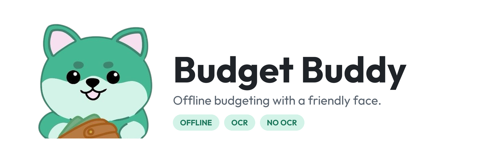

<p align="center">
  <picture>
    <source media="(prefers-color-scheme: dark)" srcset="docs/images/banner-dark.png">
    
  </picture>
</p>

<p align="center">
  
  
  
  
  
</p>

<p align="center">
  <a href="#see-it-in-action">See it in action</a> ·
  <a href="#main-features">Features</a> ·
  <a href="#choose-your-edition">Editions</a> ·
  <a href="https://github.com/Mi-N-512/Budget-Buddy/releases/latest">Download</a> ·
  <a href="#get-started">Get started</a> ·
  <a href="#open-and-build-the-project">Build</a>
</p>

Budget Buddy is an Android budgeting app that works completely offline. It shows how your money is doing this month, where it's going, and how much is left, with Budster the Budgeter reacting as you go. There's no account to create, and your records never leave the phone.

Version 3.0 is free to [download from GitHub Releases](https://github.com/Mi-N-512/Budget-Buddy/releases/latest).

To get updates automatically, add it to [Obtainium](https://github.com/ImranR98/Obtainium), which installs straight from GitHub Releases. When it asks which APK to use, pick your edition.

<a href="https://apps.obtainium.imranr.dev/redirect?r=obtainium://add/https://github.com/Mi-N-512/Budget-Buddy"></a>

## See it in action

<table>
  <tr>
    <td align="center" width="50%"></td>
    <td align="center" width="50%"></td>
  </tr>
  <tr>
    <td align="center"><b>Home.</b> Cash flow, what's left of this month's limit and your latest records.</td>
    <td align="center"><b>Analytics.</b> The gauge and charts use the same colours, so you can read them at a glance.</td>
  </tr>
  <tr>
    <td align="center"></td>
    <td align="center"></td>
  </tr>
  <tr>
    <td align="center"><b>Themes and colours.</b> Change the theme and gauge palette and see them update live.</td>
    <td align="center"><b>Receipts.</b> The OCR edition reads a receipt on the phone and suggests the details for you to check.</td>
  </tr>
</table>

## Main features

### Track your money

Record income and expenses with a date, category, amount, note and an optional receipt photo. Tap a record to see or edit it, and press and hold to delete it. History can be filtered by type, date and whether a record came from OCR.

Choose from 45 bundled currencies by name, code or symbol, or set up your own.

### Budgets and categories

Set a monthly spending limit, then split it into optional category budgets. The limit is kept separate from income; when you add income, you choose whether it also raises that month's limit. Totals are rebuilt from your saved transactions whenever you add, edit or delete one, so they stay correct.

Create your own categories with icons. Making a new category keeps the transaction you were filling in, and if you turn the option on, an unfinished transaction is also kept when you leave the screen.

### Analytics and the gauge

Analytics shows cash flow, your remaining allowance, category charts and a spending gauge. The gauge stays readable when your budget is zero or you've gone over it. Home, Analytics, the tutorial and Budster's expressions all use the same gauge colours.

### Themes and accessibility

Pick Light, Dark, Material You, true OLED black or your own colours, and preview them before you leave the screen. The gauge comes in the default green, dark yellow and red, a colour-blind-friendly blue, orange and purple, or a custom palette. Touch targets are large throughout.

### Tutorial and achievements

A six-part tutorial walks you through the real Home, Budget, Transaction, OCR, Analytics and Achievement screens, and you can replay it from Settings. Achievements include a streak for staying on budget three months in a row.

### Offline receipt reading (OCR edition)

Take a photo of a receipt or pick one from your gallery. Budget Buddy reads it on the phone with Google's bundled ML Kit text recognition, then suggests the merchant, date, total, items and a likely category. Nothing is filled in until you've seen it: you can change any field before saving, and Settings has an optional extra confirmation step.

The receipt copy and recognised text are stored in the app's private storage. The model ships inside the APK, so nothing is downloaded and the app needs no internet access. The No OCR edition leaves recognition out but can still attach receipt photos.

## Why Budget Buddy exists

Money tools should make sense at a glance. Budget Buddy puts plain totals, colour-matched spending feedback, charts, category budgets and Budster's expressions together, so you don't have to decode a spreadsheet before making a decision. Accessibility is part of the design, from the themes and colour-blind-friendly gauge to searchable currencies and a tutorial you can replay.

Offline isn't a fallback mode. Profiles, transactions, budgets, categories, receipts, settings and achievements all live in Android's private app storage and keep working in airplane mode.

## Choose your edition

Both editions are called **Budget Buddy** on the phone. Each has its own app identity, so they can be installed side by side and keep separate data.

| Edition | Android | Receipts | Size | Best fit |
| --- | --- | --- | --- | --- |
| [OCR](https://github.com/Mi-N-512/Budget-Buddy/releases/latest) | 8.1+ | Reads the photo on the phone and suggests the details | Larger, because the recognition model is included | Quicker entry when you keep receipts |
| [No OCR](https://github.com/Mi-N-512/Budget-Buddy/releases/latest) | 8.1+ | Attach a photo and type the details yourself | Smaller | Full manual control and a smaller install |

Everything else is shared: budgets, analytics, themes, the tutorial and achievements. The OCR edition's package is `com.budgetbuddy` and No OCR's is `com.budgetbuddy.manual`.

## Get started

1. Download `Budget-Buddy-OCR-v3.0-stable.apk` or `Budget-Buddy-No-OCR-v3.0-stable.apk` from [the latest release](https://github.com/Mi-N-512/Budget-Buddy/releases/latest). Only install APKs attached to this repository's releases.
2. If you like, check the file against the SHA-256 checksums in the [3.0 release notes](docs/RELEASE_NOTES_3.0_STABLE.md#sha-256-checksums).
3. Open the APK and tap **Install**. Android may ask you to allow installs from your browser or files app, and may warn that the app didn't come from the Play Store. That's normal for a direct download.
4. Open **Budget Buddy**, set up your local profile and currency, and follow the tutorial.

3.0 doesn't copy records from the old `com.example.budgetbuddy` builds, so a fresh install is recommended.

## Permissions: what it needs and why

| Access | Needed? | What it is used for |
| --- | --- | --- |
| Camera | Optional | Taking receipt photos. Saying no doesn't block manual entry or picking a photo from your gallery. |
| Photo picker | No permission | Android's photo picker only shares the photo you choose. |

Neither edition asks for internet or network access; those permissions are removed from the final app even when a library asks for them. There's no account, cloud sync, advertising, analytics or remote database.

Your data is protected by Android's app sandbox. Cloud backup and device-to-device transfer are turned off, so clearing the app's data or uninstalling an edition removes its records and receipt copies for good.

<details>
<summary>More on privacy and security</summary>

- Cleartext traffic is disabled, even though the app has no network permission.
- Only the launcher screen is exported. Internal screens and the receipt file provider are not, and a receipt's address is shared only with the camera app you use, only for that photo.
- Release builds turn off debugging and shrink code and resources.
- Receipt images are decoded at a limited size and written atomically, invalid files are rejected, and abandoned copies are deleted.
- Amounts, dates, names, categories, currencies, colours and images are checked before they're saved or used.
- Signing keys, local SDK paths, environment files, logs, build output and APKs are kept out of source control.

Google's ML Kit, used by the OCR edition, reads receipts on the phone. Google says the images and recognised text aren't sent to its servers, but its SDK terms allow it to collect technical performance and usage metrics. The OCR edition explains this in Settings.

</details>

## Open and build the project

Open the folder containing `settings.gradle.kts` in Android Studio. Use **JDK 17** or newer, install Android SDK Platform 36 and let Gradle sync. Gradle needs internet access to download dependencies; the app itself doesn't.

The two editions live on separate branches: [`main`](https://github.com/Mi-N-512/Budget-Buddy/tree/main) holds the OCR edition and [`no-ocr`](https://github.com/Mi-N-512/Budget-Buddy/tree/no-ocr) the manual one. The Gradle wrapper is included.

```powershell
# Unit tests and lint
.\gradlew.bat testDebugUnitTest
.\gradlew.bat lintDebug

# Release APK
.\gradlew.bat assembleRelease

# Instrumented tests on a connected phone or emulator
.\gradlew.bat connectedDebugAndroidTest
```

Use `./gradlew` on macOS or Linux. No environment variables, server credentials or downloaded models are needed.

It's written in Kotlin with Activity-based screens and XML layouts, using AndroidX, Material Components, MPAndroidChart and SpeedView for the charts and gauge, Glide for receipt images, and ML Kit text recognition in the OCR edition.

Start reading the code at `WelcomeActivity.kt`, which routes the first run, and `LocalDataStore.kt`, which holds all saved data. Every class starts with a comment block that explains what it does, which classes it works with, and what other classes need to know about it.

## Version 3.0 and what comes next

3.0 brings everything above together: two editions, offline OCR, the theme studio, the interactive tutorial and security hardening. See the [changelog](CHANGELOG.md) for how Budget Buddy got here, from the original online prototype to the offline 2.x releases.

Ideas I would like to include in future versions:

- **Backup and restore** to a local file, so records can move to a new phone without a cloud account.
- **Export to CSV** for spreadsheets.
- **Recurring transactions** for rent, subscriptions and salary.
- **A Home screen widget** showing what's left this month.
- **More languages**, with the interface ready for translation.

Suggestions and bug reports are welcome on the [issue tracker](https://github.com/Mi-N-512/Budget-Buddy/issues).
